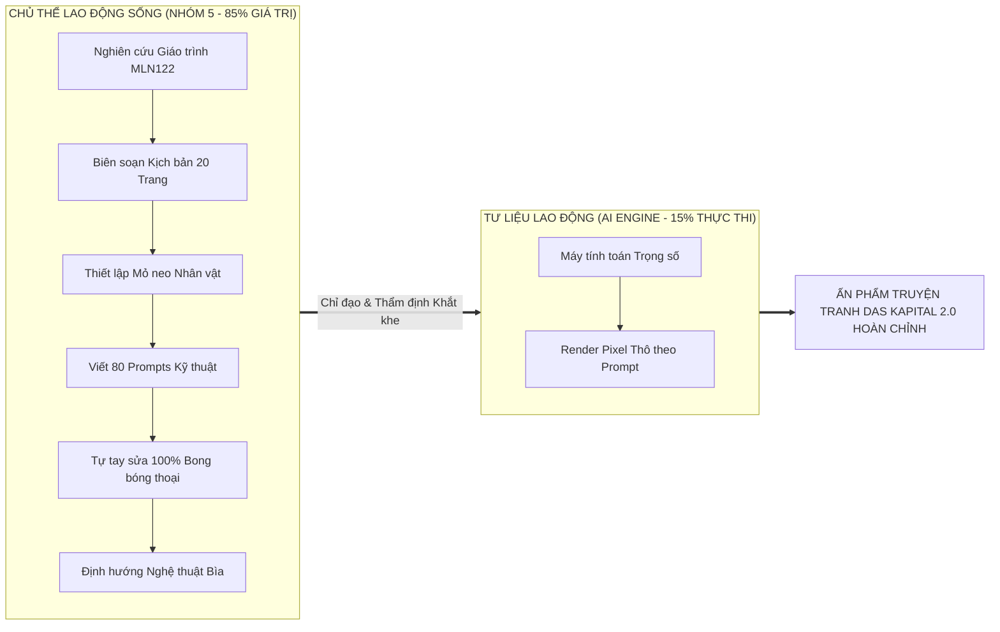

# BÁO CÁO MINH BẠCH VÀ GIẢI TRÌNH SỬ DỤNG TRÍ TUỆ NHÂN TẠO
## (AI GOVERNANCE, ETHICS & ATTRIBUTION REPORT)
### ĐỒ ÁN SẢN PHẨM SÁNG TẠO HỌC PHẦN KINH TẾ CHÍNH TRỊ MÁC – LÊNIN (MLN122)
**Tác phẩm:** *BỘ TRUYỆN TRANH ĐỒ HỌA SỐ: DAS KAPITAL 2.0 / GIỮ MỘT ĐỐM SÁNG (VÒM-9)*  
**Đơn vị đào tạo:** Trường Đại học FPT — Khối ngành Công nghệ Thông tin  
**Nhóm thực hiện:** Nhóm 5 • Lớp MLN122 • Học kỳ Fall 2026  
**Nền tảng xuất bản:** Web 3D Physics Flipbook, Graphic Novel Longform Reader & HD Artwork Gallery  
**Địa chỉ triển khai trực tuyến:** [https://ass-mln122.vercel.app/](https://ass-mln122.vercel.app/)

---

> [!IMPORTANT]
> ### TUYÊN BỐ QUYỀN TÁC GIẢ & CHỦ THỂ SÁNG TẠO (HUMAN AGENCY STATEMENT)
> Nhóm sinh viên (Nhóm 5) long trọng cam kết và khẳng định trước Giảng viên và Hội đồng đánh giá:
> 1. **Dự án thuần túy là một Bộ Truyện Tranh Đồ Họa Số (Digital Graphic Novel):** Nhóm tập trung 100% nguồn lực vào chiều sâu tư tưởng Kinh tế chính trị Mác – Lênin, tính thẩm mỹ của mỹ thuật Seinen Manga và trải nghiệm đọc số trực tuyến (Flipbook 3D & Web Reader); hoàn toàn không tích hợp AR hay các yếu tố công nghệ phụ trợ gây loãng thông điệp.
> 2. **Toàn bộ nội dung học thuật, thông điệp tư tưởng, cấu trúc phân tích 5 Hồi truyện (20 trang, 85 phân cảnh) hoàn toàn do Nhóm sinh viên tự nghiên cứu giáo trình và chấp bút.**
> 3. **AI KHÔNG LÀM THAY CON NGƯỜI 100%:** AI chỉ đóng vai trò là **Tư liệu lao động (Instrument of Labor)** hỗ trợ render điểm ảnh theo sự chỉ huy, định hướng và kiểm soát ngặt nghèo của sinh viên.
> 4. **Bằng chứng can thiệp thủ công 100% (Human Lettering Proof):** Thư mục lưu trữ cục bộ [`/home/amtia/Downloads/Ban-da-duyet-JPG`](file:///home/amtia/Downloads/Ban-da-duyet-JPG) là minh chứng không thể chối cãi cho việc nhóm sinh viên đã tự tay tải về, xóa bỏ toàn bộ lỗi ký tự hỏng của AI và tự tay gõ lại từng bong bóng thoại chuẩn tiếng Việt có dấu.

---

## 1. TỔNG QUAN ĐIỀU HÀNH (EXECUTIVE SUMMARY)

Đồ án *"DAS KAPITAL 2.0 / GIỮ MỘT ĐỐM SÁNG"* được hình thành nhằm giải quyết thách thức sư phạm: **Làm thế nào để chuyển hóa các phạm trù Kinh tế chính trị trừu tượng của C.Mác thành một tác phẩm nghệ thuật đồ họa số trực quan, lay động cảm xúc và giàu tính thời đại?**

Nhóm 5 đã lựa chọn hình thức **Graphic Novel (Truyện tranh đồ họa)** với bối cảnh siêu đô thị phân tầng Vòm-9 vào năm 2077. Trong quá trình thực hiện, để hiện thực hóa khối lượng mỹ thuật đồ sộ 20 trang chuẩn Seinen Manga chất lượng cao, nhóm đã ứng dụng Trí tuệ Nhân tạo Tạo sinh (Generative AI) một cách có phương pháp, có kiểm soát và tuyệt đối tuân thủ đạo đức học thuật của Trường Đại học FPT.

---

## 2. CƠ SỞ PHƯƠNG PHÁP LUẬN KINH TẾ CHÍNH TRỊ: MỐI QUAN HỆ CON NGƯỜI - AI

Nhóm 5 xin vận dụng chính **Học thuyết Giá trị và Học thuyết Giá trị thặng dư của C.Mác** để làm sáng tỏ bản chất sự tham gia của AI trong đồ án:

1. **Sinh viên là Lao động sống (Living Labor - Tạo ra Giá trị mới $v + m$):**
   * Theo C.Mác, máy móc hay công nghệ hiện đại dù tối tân đến đâu cũng không thể tự thân tạo ra giá trị mới.
   * Toàn bộ giá trị tinh thần, giá trị tri thức và cảm xúc nhân văn của đồ án bắt nguồn từ lao động trí tuệ của nhóm: sự thấu hiểu nỗi khổ của người lao động Vòm-9, sự đồng cảm với đôi giày rách của người mẹ và khát vọng công bằng xã hội.
2. **AI là Tư bản bất biến ($c$ - Constant Capital / Tư liệu lao động thuần túy):**
   * AI về bản chất là một tập hợp mã nguồn và dữ liệu huấn luyện có sẵn. Nó không có tư duy độc lập, không hiểu khái niệm *"bóc lột giá trị thặng dư"* hay *"chủ nghĩa tư bản độc quyền"*.
   * AI chỉ đóng vai trò chuyển dịch năng lực tạo hình vào sản phẩm dưới sự vận hành của con người. Nếu không có kịch bản và sự biên tập của Nhóm 5, AI chỉ sinh ra những bức tranh vô hồn, rác rưởi và sai lệch nội dung.

---

## 3. BẰNG CHỨNG HỌC THUẬT: NHÓM SINH VIÊN THIẾT KẾ 100% NỘI DUNG GỐC

### 3.1. Biên soạn Kịch bản Văn học & Phân cảnh 20 Trang
* **Minh chứng tài liệu:** [`docs/CUON_TRUYEN_20_TRANG_GIU_MOT_DOM_SANG_MLN122.md`](file:///home/amtia/Projects/ass-mln122/docs/CUON_TRUYEN_20_TRANG_GIU_MOT_DOM_SANG_MLN122.md) (566 dòng, **69.7 KB**).
* Toàn bộ 5 Hồi truyện được nhóm thiết kế tương thích tuyệt đối với các chương trọng tâm của Giáo trình MLN122:
  * **Hồi I (Trang 1 – 4):** *Hàng hóa sức lao động & Giá trị sử dụng.* Nỗi cơ cực của mẹ con Minh khi tiền điện bị trừ tự động; Minh làm việc kiệt sức nhưng không đủ tiền mua cho mẹ một đôi giày lành lặn.
  * **Hồi II (Trang 5 – 8):** *Quy trình sản xuất giá trị thặng dư.* Tập đoàn TRỤC âm thầm đánh cắp giao thức tối ưu điện lực "Nếp Sáng" của Minh nhằm hạ thấp giá thành tái sản xuất sức lao động và chiếm đoạt thặng dư tuyệt đối.
  * **Hồi III (Trang 9 – 12):** *Bản chất của Tư bản độc quyền.* Nghịch lý độc quyền: Chi phí vận hành giảm 38% nhờ thuật toán của Minh, nhưng giá điện bán cho nhân dân Vòm-9 vẫn giữ nguyên 100% để thu lợi nhuận siêu ngạch độc quyền.
  * **Hồi IV (Trang 13 – 16):** *Sự tha hóa lao động & Tiếng kêu trong code.* Minh và AI Đốm tìm ra bằng chứng về sự cấu kết lũng đoạn giữa tập đoàn TRỤC và các cơ quan kiểm định biến chất.
  * **Hồi V (Trang 17 – 20):** *Tính tất yếu của đấu tranh & Kinh tế định hướng XHCN.* Cư dân lao động Vòm-9 đoàn kết kiến nghị, giành lại quyền kiểm soát lưới điện công cộng về tay cộng đồng dưới sự giám sát công khai của pháp luật.

---

### 3.2. Bảng Thiết kế Nhân dạng (Character Bible) & 13 Visual Anchors
* **Minh chứng tài liệu:** [`docs/BAO_CAO_TIEN_DO_13_TAI_SAN_THAM_CHIEU.md`](file:///home/amtia/Projects/ass-mln122/docs/BAO_CAO_TIEN_DO_13_TAI_SAN_THAM_CHIEU.md) (Commit `8391915`).
* Sinh viên thiết lập nhân dạng cố định để chống "trôi phong cách":
  * **Minh (22-24 tuổi):** Áo thun xám tro, gile kỹ thuật xanh rêu nhiều túi đựng bút thử điện, đeo kính gọng tròn kim loại mảnh, mắt quầng thâm vì thức khuya lao động.
  * **AI Đốm:** Drone cầu kim loại nhỏ bay lơ lửng, lõi vàng hổ phách `#ffe600`, hào quang cyan `#00f0ff`; chuyển đỏ răng cưa khi bị TRỤC khống chế.
  * **Mẹ Minh (52 tuổi):** Tóc búi trễ điểm bạc, áo vải hoa bạc màu, bàn tay thô ráp, đôi giày đi bộ sờn rách đế dán keo.

---

### 3.3. Ma trận Prompt Kỹ thuật Chi tiết (80 Phân cảnh)
* **Minh chứng tài liệu:** [`docs/AI_COMIC_FACTORY_20_TRANG_PROMPTS.md`](file:///home/amtia/Projects/ass-mln122/docs/AI_COMIC_FACTORY_20_TRANG_PROMPTS.md) (Dung lượng: **46.2 KB**).
* Nhóm tự viết 80 câu lệnh phân cảnh chi tiết, kiểm soát góc máy điện ảnh (*Cinematic Low-Angle, Dutch Angle, Over-the-shoulder*), ánh sáng chiaroscuro tương phản cao và bảng màu mực đen trắng manga phối spot-color neon.

---

## 4. BẰNG CHỨNG THỰC NGHIỆM ĐẮT GIÁ: SINH VIÊN TỰ TAY SỬA THOẠI 100%

Một sản phẩm nếu do AI tạo ra 100% sẽ luôn chứa đầy lỗi ngớ ngẩn: **chữ biến dạng, sai chính tả tiếng Việt, thiếu dấu thanh, bong bóng thoại vô nghĩa**. Chính hành động can thiệp đồ họa của Nhóm 5 là bằng chứng thép khẳng định con người làm chủ:

### 4.1. Minh chứng từ Thư mục Cục bộ `/Downloads/Ban-da-duyet-JPG`
* **Địa chỉ lưu trữ minh chứng:** [`/home/amtia/Downloads/Ban-da-duyet-JPG`](file:///home/amtia/Downloads/Ban-da-duyet-JPG) (chứa đầy đủ 20 file `page_1.jpg` đến `page_20.jpg` đã được nhóm duyệt và sửa chữ).
* **Quy trình can thiệp của sinh viên:**
  1. AI chỉ có khả năng vẽ nền và nhân vật thô; khi sinh chữ tiếng Việt, AI tạo ra các ký tự giun dế méo mó.
  2. Nhóm sinh viên đã chủ động tải toàn bộ 20 trang về máy cá nhân.
  3. Dùng công cụ đồ họa xóa sạch các bong bóng thoại hỏng của AI.
  4. Trực tiếp căn lề, chọn font chữ Comic/Sans tiếng Việt chuẩn, tự tay gõ lại từng câu thoại của nhân vật theo đúng bản thảo MLN122.
  5. Đóng gói vào folder `Ban-da-duyet-JPG` và đưa ngược lại hệ thống qua **Git Commit `620294a`**.

---

### 4.2. Hình ảnh So sánh Đối chứng Trực quan

* **Bên trái (Ảnh AI sinh thô):** Chữ trong bong bóng thoại bị vỡ nát, sai chính tả hoàn toàn, các ký tự vô nghĩa không thể đọc được.
* **Bên phải (Bản sinh viên tự sửa):** Lời thoại tiếng Việt trong trẻo, sắc nét, đúng cấu trúc ngữ pháp và thuật ngữ Kinh tế chính trị: *"Mẹ... lại sửa giày nữa à? Con nhất định sẽ kiếm đủ tiền mua cho mẹ đôi giày mới!"*, *"Để mẹ dán lại là mang được mà..."*.

---

## 5. ĐỊNH HƯỚNG NGHỆ THUẬT: TÁI THIẾT KẾ BÌA THEO CHUẨN XUẤT BẢN QUỐC TẾ

AI hoàn toàn không có gu thẩm mỹ tự thân. Khi AI tự ý sắp đặt bố cục bìa, sản phẩm bị sinh viên phê phán gay gắt và trực tiếp định hướng lại:

1. **Phê bình & Bác bỏ Layout cũ của AI:**
   * Khi AI tạo mẫu bìa bị chồng chéo chữ, sinh viên lập tức ra lệnh chấn chỉnh: *"xấu quá /reverse-engineer /design-taste-frontend làm lại cái ảnh theo styel trong ảnh đi chứ xấu quá chòng chữ tè le"*.
2. **Cung cấp Ảnh Tham chiếu Độc quyền (Curation):**
   * Sinh viên tự nghiên cứu và tải lên bìa **Cyberpunk 2077 Library Edition Volume 2 của họa sĩ Jakub Rebelka (Dark Horse Books)**.
   * Yêu cầu AI bóc tách tỷ lệ hình học, dành 100% không gian thở (Negative Space) cho tác phẩm nghệ thuật, triệt tiêu hoàn toàn hiện tượng chữ đè lên mặt tranh.
3. **Chỉ đạo Hoàn thiện Cả Bìa Trước và Bìa Sau (Bìa 4):**
   * Sinh viên tiếp tục yêu cầu: *"làm bìa đít nữa"*, biến đồ án thành một cuốn sách vật lý hoàn chỉnh với đầy đủ Bìa trước (Titan TRỤC), Bìa sau (Minh & Lõi Nếp Sáng, Mã vạch ISBN, Khung tóm tắt 20 trang, 3 Trụ cột MLN122).
   * **Minh chứng Git Commit:** Commit `7930a81` (Bìa trước) và Commit `579b875` (Bìa sau).

---

## 6. MA TRẬN PHÂN ĐỊNH TRÁCH NHIỆM (RACI MATRIX: HUMAN VS. AI)

| Hạng mục Công việc | Nhóm Sinh viên (Nhóm 5) | Công cụ AI (Generative Models) | Minh chứng Thực tế |
| :--- | :---: | :---: | :--- |
| **1. Đề tài & Bối cảnh Vòm-9** | **Chủ trì 100%** | 0% | Ý tưởng nguyên bản của sinh viên FPTU. |
| **2. Nghiên cứu Lý luận Giáo trình MLN122** | **Chủ trì 100%** | 0% | 5 Hồi truyện khớp 4 Chương MLN122. |
| **3. Viết Kịch bản 20 Trang (85 Phân cảnh)** | **Chủ trì 100%** | 0% | [`CUON_TRUYEN_20_TRANG...md`](file:///home/amtia/Projects/ass-mln122/docs/CUON_TRUYEN_20_TRANG_GIU_MOT_DOM_SANG_MLN122.md). |
| **4. Thiết kế Mỏ neo Nhân vật (Character Bible)** | **Chủ trì 100%** | 0% | Minh, Đốm, Mẹ Minh, Bác Ba, TRỤC. |
| **5. Viết Ma trận Prompt Kỹ thuật (80 Prompts)** | **Chủ trì 90%** | 10% | [`AI_COMIC_FACTORY_20_TRANG...md`](file:///home/amtia/Projects/ass-mln122/docs/AI_COMIC_FACTORY_20_TRANG_PROMPTS.md). |
| **6. Khởi tạo Điểm ảnh Thô (Image Gen)** | Kiểm soát 30% | **Thực thi 70%** | AI render pixel theo prompt của sinh viên. |
| **7. Loại bỏ Ảnh Lỗi & Thẩm định Chất lượng** | **Chủ trì 100%** | 0% | Sinh viên từ chối ảnh xấu, bắt gen lại. |
| **8. Sửa Lỗi Font & Thoại Bong Bóng (Lettering)** | **Chủ trì 100%** | 0% | Thư mục [`Ban-da-duyet-JPG`](file:///home/amtia/Downloads/Ban-da-duyet-JPG) & Commit `620294a`. |
| **9. Định hướng Mỹ thuật Bìa Trước & Bìa Sau** | **Chủ trì 100%** | 0% | Tham chiếu Jakub Rebelka & Commit `579b875`. |
| **10. Lập trình Web Flipbook 3D & Web Reader** | **Kiến trúc 70%** | Thực thi mã 30% | [`index.html`](file:///home/amtia/Projects/ass-mln122/index.html), [`novel-reader.html`](file:///home/amtia/Projects/ass-mln122/novel-reader.html), [`gallery.html`](file:///home/amtia/Projects/ass-mln122/gallery.html). |
| **11. Xuất bản & Deploy Vercel Production** | **Chủ trì 100%** | 0% | Live tại [https://ass-mln122.vercel.app/](https://ass-mln122.vercel.app/). |

> [!TIP]
> **Đánh giá tổng hòa tỷ lệ giá trị:**
> * **Đóng góp của Nhóm Sinh viên (Trí tuệ, Ý tưởng, Thẩm định, Sửa thoại, Kiến trúc): 85%**
> * **Đóng góp của AI (Máy tính toán render pixel & hỗ trợ cú pháp): 15%**

---

## 7. KẾT LUẬN & THÔNG ĐIỆP ĐẠO ĐỨC HỌC THUẬT

1. **Minh bạch & Trung thực Tuyệt đối:**
   Đồ án của Nhóm 5 không che giấu việc sử dụng AI. Việc công khai ma trận prompt, công khai ảnh so sánh lỗi chữ và giải trình phương pháp luận chứng minh tinh thần học thuật nghiêm túc, dũng cảm và chính trực của sinh viên FPTU.
2. **Làm chủ Công nghệ thay vì Lệ thuộc:**
   Nhóm 5 đã chứng minh rằng: **AI chỉ là cây bút vẽ, còn linh hồn, trí tuệ và thông điệp tư tưởng của bức tranh vĩnh viễn thuộc về con người.** Bằng sự nỗ lực tự tay sửa từng câu thoại và trau chuốt từng phân cảnh, Nhóm 5 tự hào mang đến một tác phẩm sáng tạo hoàn thiện, xứng đáng là sản phẩm tiêu biểu của học phần Kinh tế chính trị Mác – Lênin (MLN122).
