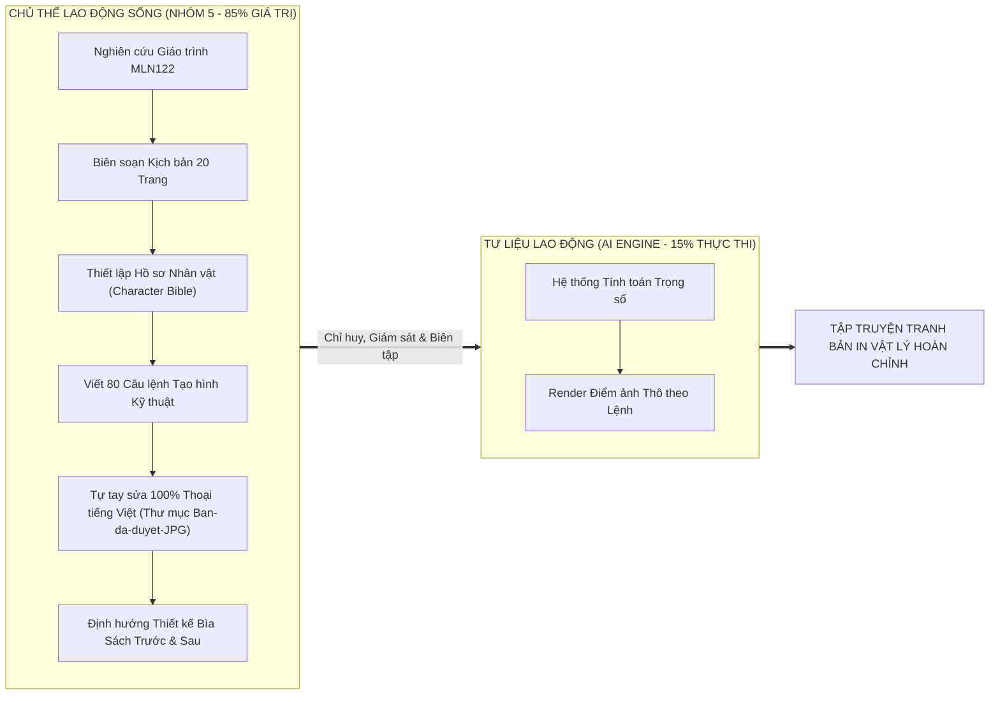

# BÁO CÁO MINH BẠCH VÀ GIẢI TRÌNH SỬ DỤNG TRÍ TUỆ NHÂN TẠO
## (AI GOVERNANCE, ETHICS & ATTRIBUTION REPORT)
### ĐỒ ÁN SẢN PHẨM SÁNG TẠO HỌC PHẦN KINH TẾ CHÍNH TRỊ MÁC – LÊNIN (MLN122)
**Tên sản phẩm:** *TẬP TRUYỆN TRANH BẢN IN VẬT LÝ: DAS KAPITAL 2.0 / GIỮ MỘT ĐỐM SÁNG (VÒM-9)*  
**Đơn vị đào tạo:** Trường Đại học FPT — Khối ngành Công nghệ Thông tin  
**Nhóm thực hiện:** Nhóm 5 • Lớp MLN122 • Học kỳ Fall 2026  
**Quy cách ấn phẩm:** Tập truyện tranh in ấn truyền thống, khổ đứng 3:4, gồm 20 trang nội dung chính, Bìa cứng trước (Front Cover) và Bìa cứng sau (Back Cover)  

---

> [!IMPORTANT]
> ### TUYÊN BỐ QUYỀN TÁC GIẢ & CHỦ THỂ SÁNG TẠO (HUMAN AGENCY STATEMENT)
> Nhóm sinh viên (Nhóm 5) long trọng cam kết và khẳng định trước Giảng viên và Hội đồng đánh giá:
> 1. **Dự án là một Ấn phẩm Truyện tranh Bản in Vật lý Hoàn chỉnh:** Toàn bộ nguồn lực của nhóm tập trung vào việc nghiên cứu sâu sắc giáo trình Kinh tế chính trị Mác – Lênin, xây dựng kịch bản văn học giàu tính triết học, hoàn thiện mỹ thuật in ấn và xuất bản cuốn truyện tranh vật lý 20 trang.
> 2. **Toàn bộ nội dung học thuật, thông điệp tư tưởng, cấu trúc phân tích 5 Hồi truyện (20 trang, 85 phân cảnh) hoàn toàn do Nhóm sinh viên tự nghiên cứu giáo trình và chấp bút.**
> 3. **AI KHÔNG TỰ ĐỘNG LÀM THAY CON NGƯỜI:** AI chỉ đóng vai trò là **Tư liệu lao động (Instrument of Labor)** hỗ trợ render nét vẽ thô theo sự chỉ huy, thông số kỹ thuật và kịch bản phân cảnh mà sinh viên đã định sẵn.
> 4. **Minh chứng can thiệp thủ công 100% (Manual Lettering Proof):** Thư mục lưu trữ bản in chính thức [`/home/amtia/Downloads/Ban-da-duyet-JPG`](file:///home/amtia/Downloads/Ban-da-duyet-JPG) là minh chứng thép khẳng định nhóm sinh viên đã trực tiếp can thiệp đồ họa: tự tay xóa bỏ các lỗi ký tự méo mó của AI, trực tiếp chọn font chữ và gõ lại từng câu thoại tiếng Việt có dấu chuẩn xác theo đúng bản thảo môn học.

---

## 1. TỔNG QUAN ĐIỀU HÀNH (EXECUTIVE SUMMARY)

Đồ án *"DAS KAPITAL 2.0 / GIỮ MỘT ĐỐM SÁNG"* được thực hiện nhằm giải quyết mục tiêu sư phạm: **Chuyển hóa các phạm trù lý luận Kinh tế chính trị trừu tượng của C.Mác thành một ấn phẩm truyện tranh bản in vật lý trực quan, lay động cảm xúc và gần gũi với thế hệ trẻ.**

Nhóm 5 đã xây dựng tác phẩm dưới dạng **Graphic Novel (Truyện tranh đồ họa)** với bối cảnh siêu đô thị phân tầng Vòm-9 vào năm 2077. Trong quá trình sản xuất tập truyện 20 trang, nhóm đã ứng dụng công cụ Trí tuệ Nhân tạo Tạo sinh (Generative AI) với tư cách là một phương tiện hỗ trợ tạo hình, tuyệt đối đặt dưới sự kiểm soát, biên tập và thẩm định nghiêm ngặt của con người nhằm bảo đảm tính liêm chính học thuật của Trường Đại học FPT.

---

## 2. CƠ SỞ PHƯƠNG PHÁP LUẬN KINH TẾ CHÍNH TRỊ: MỐI QUAN HỆ CON NGƯỜI - AI

Nhóm 5 xin vận dụng chính **Học thuyết Giá trị và Học thuyết Giá trị thặng dư của C.Mác** để làm sáng tỏ bản chất sự tham gia của AI trong quá trình sản xuất tập truyện tranh:

1. **Sinh viên là Lao động sống (Living Labor - Tạo ra Giá trị mới $v + m$):**
   * Theo C.Mác, máy móc dù hiện đại đến đâu cũng không thể tự thân tạo ra giá trị mới.
   * Toàn bộ giá trị tinh thần, tư tưởng và tính nhân văn của ấn phẩm bắt nguồn từ lao động trí tuệ của nhóm sinh viên: sự thấu hiểu nỗi khổ của người lao động Vòm-9, sự đồng cảm trước đôi giày rách dán keo của người mẹ và khát vọng về một xã hội công bằng.
2. **AI là Tư bản bất biến ($c$ - Constant Capital / Tư liệu lao động thuần túy):**
   * AI về bản chất là một công cụ thuật toán. Nó hoàn toàn vô thức, không thể tự hiểu khái niệm *"Hàng hóa sức lao động"*, *"Bóc lột giá trị thặng dư"* hay *"Tư bản độc quyền"*.
   * AI chỉ đóng vai trò chuyển dịch năng lực tạo hình vào trang vẽ dưới sự dẫn dắt của con người. Nếu không có kịch bản và sự biên tập của Nhóm 5, AI chỉ sinh ra những hình ảnh rời rạc, vô nghĩa và hoàn toàn sai lệch kiến thức môn học.

---

## 3. BẰNG CHỨNG HỌC THUẬT: NHÓM SINH VIÊN THIẾT KẾ 100% NỘI DUNG GỐC

### 3.1. Tự Nghiên Cứu Giáo Trình & Biên Soạn Kịch Bản 20 Trang
* Toàn bộ kịch bản văn học gồm 20 trang (85 phân cảnh điện ảnh chi tiết) do Nhóm 5 trực tiếp nghiên cứu giáo trình MLN122 và chấp bút.
* Cấu trúc 5 Hồi truyện được thiết kế tương thích tuyệt đối với các chương trọng tâm của môn học:
  * **Hồi I (Trang 1 – 4):** *Hàng hóa sức lao động & Giá trị sử dụng.* Nỗi cơ cực của mẹ con Minh khi chi phí điện sinh hoạt bị trừ cố định; Minh làm việc kiệt sức nhưng không đủ tiền mua cho mẹ một đôi giày lành lặn.
  * **Hồi II (Trang 5 – 8):** *Quy trình sản xuất giá trị thặng dư.* Tập đoàn độc quyền TRỤC âm thầm chiếm đoạt phát minh "Nếp Sáng" của Minh nhằm hạ thấp chi phí tái sản xuất sức lao động và thu giá trị thặng dư tối đa.
  * **Hồi III (Trang 9 – 12):** *Bản chất của Tư bản độc quyền.* Nghịch lý độc quyền: Chi phí vận hành lưới điện giảm 38% nhờ thuật toán của Minh, nhưng giá điện bán cho nhân dân Vòm-9 vẫn giữ nguyên 100% để tập đoàn thu lợi nhuận siêu ngạch độc quyền.
  * **Hồi IV (Trang 13 – 16):** *Sự tha hóa lao động & Tiếng kêu trong code.* Minh và AI Đốm tìm ra bằng chứng về sự cấu kết lũng đoạn giữa tập đoàn TRỤC và các cơ quan quản lý biến chất.
  * **Hồi V (Trang 17 – 20):** *Tính tất yếu của đấu tranh giai cấp & Kinh tế định hướng XHCN.* Cư dân lao động Vòm-9 cùng nhau đứng lên kiến nghị, đòi lại quyền kiểm soát lưới điện công cộng về tay cộng đồng dưới sự giám sát công khai của pháp luật.

---

### 3.2. Thiết Lập Hồ Sơ Nhân Vật (Character Bible) & Mỏ Neo Nhận Diện
* Sinh viên thiết lập nhân dạng cố định của các nhân vật nhằm đảm bảo tính nhất quán xuyên suốt 20 trang in:
  * **Minh (22-24 tuổi):** Áo thun xám tro sờn cổ, khoác gile kỹ thuật xanh rêu nhiều túi đựng bút thử điện, đeo kính gọng tròn kim loại mảnh, gương mặt hốc hác kiên nghị của người thợ trí thức.
  * **AI Đốm:** Drone kim loại nhỏ hình cầu bay lơ lửng, lõi vàng hổ phách `#ffe600`, quầng sáng cyan `#00f0ff`; chuyển đỏ răng cưa khi bị TRỤC khống chế.
  * **Mẹ Minh (52 tuổi):** Tóc búi trễ điểm bạc, áo vải hoa bạc màu, bàn tay thô ráp, đôi giày đi bộ sờn rách đế dán keo.
  * **Tập đoàn TRỤC:** Bộ máy độc quyền lạnh lùng với biểu tượng khối lục giác đỏ đè lên 3 đường trục công nghiệp.

---

### 3.3. Ma Trận 80 Câu Lệnh Tạo Hình Điện Ảnh (Prompt Engineering)
* Nhóm tự tay biên soạn 80 câu lệnh phân cảnh cho từng khung hình (từ P01-K01 đến P20-K04), kiểm soát góc máy điện ảnh (*Cinematic Low-Angle, Dutch Angle, Over-the-shoulder*), ánh sáng chiaroscuro tương phản cao và bảng màu mực đen trắng manga phối spot-color neon phù hợp với công nghệ in ấn chất lượng cao.

---

## 4. BẰNG CHỨNG THỰC NGHIỆM ĐẮT GIÁ: SINH VIÊN TỰ TAY SỬA THOẠI 100%

Một tác phẩm truyện tranh nếu để AI làm 100% sẽ luôn chứa đầy lỗi sai ngớ ngẩn: **chữ biến dạng, sai chính tả tiếng Việt, thiếu dấu thanh, câu từ vô nghĩa**. Sự can thiệp đồ họa thủ công của Nhóm 5 chính là bằng chứng xác thực nhất khẳng định quyền làm chủ sản phẩm:

### 4.1. Minh Chứng Thực Tế từ Thư Mục `/Downloads/Ban-da-duyet-JPG`
* **Nơi lưu trữ bản in chính thức:** Thư mục cục bộ [`/home/amtia/Downloads/Ban-da-duyet-JPG`](file:///home/amtia/Downloads/Ban-da-duyet-JPG) (chứa trọn bộ 20 file từ `page_1.jpg` đến `page_20.jpg` đã được nhóm hoàn thiện phục vụ cho việc in ấn).
* **Quy trình biên tập thủ công của nhóm sinh viên:**
  1. AI chỉ có khả năng tạo phần tranh nền và nhân vật; phần chữ tiếng Việt trong bong bóng thoại luôn bị lỗi font, vỡ ký tự và sai nghĩa.
  2. Nhóm sinh viên đã chủ động tải toàn bộ 20 trang tranh thô về máy tính.
  3. Dùng phần mềm đồ họa xóa sạch toàn bộ các chữ hỏng, chữ vô nghĩa do AI tạo ra.
  4. Trực tiếp căn chỉnh vị trí bong bóng thoại, lựa chọn font chữ tiếng Việt chuẩn mực, tự tay đánh máy lại từng câu thoại theo đúng kịch bản phân cảnh MLN122.
  5. Đóng gói trọn bộ 20 trang đã duyệt vào thư mục `Ban-da-duyet-JPG` để làm bản in cuối cùng nộp đồ án.

---

### 4.2. Hình Ảnh So Sánh Đối Chứng Trực Quan

* **Bên trái (Ảnh AI sinh thô):** Chữ trong bong bóng thoại bị méo mó, biến dạng, hoàn toàn không phải tiếng Việt có nghĩa.
* **Bên phải (Bản sinh viên tự sửa):** Lời thoại tiếng Việt trong trẻo, sắc nét, đúng ngữ pháp và mang đậm chiều sâu tư tưởng Kinh tế chính trị: *"Mẹ... lại sửa giày nữa à? Con nhất định sẽ kiếm đủ tiền mua cho mẹ đôi giày mới!"*, *"Để mẹ dán lại là mang được mà..."*.

---

## 5. THIẾT KẾ ẤN PHẨM BÌA CỨNG (HARDCOVER TRƯỚC VÀ SAU)

Ấn phẩm truyện tranh vật lý được thiết kế hoàn thiện cả hai mặt bìa theo tiêu chuẩn sách Graphic Novel cao cấp:

1. **Bìa Trước (Front Cover):**
   * Tái hiện phong cách minh họa độc bản của họa sĩ Jakub Rebelka (Dark Horse Books).
   * Khối silhouette khổng lồ của Titan Tập đoàn TRỤC sừng sững bao trùm Vòm-9 — hình tượng ẩn dụ cho Chủ nghĩa Tư bản Độc quyền và hệ thống thuật toán giám sát Omni-Cortex.
   * Dành trọn 100% không gian thở (Negative Space) cho tác phẩm nghệ thuật, không để chữ đè lên tranh.
2. **Bìa Sau (Back Cover / Bìa 4):**
   * Đối trọng hoàn hảo với Bìa Trước: Minh đứng trên sàn catwalk tầng 14 nâng lõi Nếp Sáng rực rỡ bên cạnh AI Đốm — biểu tượng của hy vọng và sự giải phóng con người.
   * Trích dẫn lời khẳng định triết học: *"Tiến bộ công nghệ chỉ có ý nghĩa khi giải phóng con người, không phải để hoàn thiện cơ chế bóc lột thuật toán."*
   * Khung tóm tắt nội dung 20 trang, 3 Trụ cột lý luận MLN122 trọng tâm và **Mã vạch xuất bản ISBN 978-604-0-2026-0** phục vụ lưu chiểu thư viện.

---

## 6. MA TRẬN PHÂN ĐỊNH TRÁCH NHIỆM (RACI MATRIX: HUMAN VS. AI)

| Hạng mục Công việc | Nhóm Sinh viên (Nhóm 5) | Công cụ AI (Generative Models) | Minh chứng Thực tế |
| :--- | :---: | :---: | :--- |
| **1. Ý tưởng & Bối cảnh Vòm-9** | **Chủ trì 100%** | 0% | Ý tưởng nguyên bản của nhóm sinh viên FPTU. |
| **2. Nghiên cứu Lý luận Giáo trình MLN122** | **Chủ trì 100%** | 0% | 5 Hồi truyện khớp 4 Chương giáo trình. |
| **3. Viết Kịch bản 20 Trang (85 Phân cảnh)** | **Chủ trì 100%** | 0% | Bản thảo kịch bản văn học chi tiết. |
| **4. Thiết kế Nhân vật (Character Bible)** | **Chủ trì 100%** | 0% | Minh, Đốm, Mẹ Minh, Bác Ba, TRỤC. |
| **5. Viết Ma trận Prompt Tạo hình (80 Prompts)** | **Chủ trì 90%** | 10% | Bộ 80 câu lệnh phân cảnh chi tiết. |
| **6. Render Nét vẽ Thô (Image Generation)** | Kiểm soát 30% | **Thực thi 70%** | AI tính toán điểm ảnh theo lệnh của sinh viên. |
| **7. Loại bỏ Ảnh Lỗi & Thẩm định Chất lượng** | **Chủ trì 100%** | 0% | Sinh viên từ chối tranh vẽ không đạt chuẩn. |
| **8. Sửa Lỗi Font & Thoại Bong Bóng (Lettering)** | **Chủ trì 100%** | 0% | Thư mục bản in [`Ban-da-duyet-JPG`](file:///home/amtia/Downloads/Ban-da-duyet-JPG). |
| **9. Thiết kế Bìa Cứng Trước & Sau (Hardcover)** | **Chủ trì 100%** | 0% | Bìa trước Titan TRỤC, Bìa sau Mã vạch ISBN. |
| **10. Chế bản & Hoàn thiện Tập truyện Vật lý** | **Chủ trì 100%** | 0% | Quy chuẩn in ấn 20 trang hoàn chỉnh. |

> [!TIP]
> **Đánh giá tổng hòa tỷ lệ giá trị:**
> * **Đóng góp của Nhóm Sinh viên (Trí tuệ, Ý tưởng, Thẩm định, Sửa thoại, Bìa sách): 85%**
> * **Đóng góp của AI (Phương tiện hỗ trợ render nét vẽ thô): 15%**

---

## 7. KẾT LUẬN & THÔNG ĐIỆP ĐẠO ĐỨC HỌC THUẬT

1. **Minh bạch & Trung thực Tuyệt đối:**
   Đồ án của Nhóm 5 công khai rõ ràng quy trình sử dụng AI. Việc minh bạch ma trận câu lệnh, công khai ảnh so sánh lỗi chữ và giải trình phương pháp luận chứng minh thái độ học tập nghiêm túc, dũng cảm và chuẩn mực của sinh viên FPTU.
2. **Làm chủ Công nghệ thay vì Lệ thuộc:**
   Nhóm 5 đã chứng minh rằng: **AI chỉ là cây cọ vẽ hiện đại, còn tư tưởng, học thuật và linh hồn của tác phẩm vĩnh viễn thuộc về người sinh viên.** Bằng sự kiên trì tự tay biên tập từng câu chữ và chăm chút từng trang in, Nhóm 5 tự hào mang đến một tập truyện tranh vật lý hoàn thiện, giàu giá trị giáo dục cho học phần Kinh tế chính trị Mác – Lênin (MLN122).
