# KẾ HOẠCH THỰC THI: TÁI THIẾT TOÀN DIỆN 20 TRANG MANGA CYBERPUNK (TRANG 1 → 20)
**Học phần:** Kinh tế chính trị Mác - Lênin (MLN122)  
**Tác phẩm:** *DAS KAPITAL 2.0 / GIỮ MỘT ĐỐM SÁNG*  
**Hệ thống Neo Tham Chiếu:** 13 Tài sản Cố định Đã Hoàn Thiện (7 Nhân vật, 1 Đạo cụ Nếp Sáng, 5 Bối cảnh Không gian)  
**Aesthetic Core (Manga Chuẩn Nhật Bản - Selective Neon Accents):** 
- **Mực vẽ & Trame Manga:** Nét mực đen Katsuhiro Otomo và Tsutomu Nihei dứt khoát, sắc bén; đổ bóng hạt screentone halftone xám mịn, tương phản chiaroscuro cao trên nền giấy manga ngà `#f4f1ea` và nền tối `#05060a`.
- **Spot Color / Điểm Nhấn Neon Chọn Lọc:** **TUYỆT ĐỐI KHÔNG DÙNG FULL-COLOR MÀU MÈ**. Toàn bộ tranh là đen - trắng - xám manga, CHỈ tô màu neon phát sáng nổi bật cho các chi tiết then chốt (Mắt LED cyan `#00f0ff` của Đốm và HUD dữ liệu, Lõi vàng hổ phách `#ffe600` của Nếp Sáng, Đỏ thẫm `#ff0055` của cảnh báo cưỡng chế TRỤC).
- **Tích Hợp Text & Thoại Trong Tranh (In-Panel Lettering):** Mọi trang BẮT BUỘC có bóng thoại manga (speech balloons) viền đen trắng chứa lời thoại nhân vật, hộp dẫn chuyện (caption boxes) ở góc khung hình, và chữ hiệu ứng âm thanh (Manga Onomatopoeia SFX: *TÍCH!*, *RẮC!*, *KENG!*, *VÙ...*).

---

## 0. QUY TẮC BẮT BUỘC KHÓA NHẬN DIỆN (ZERO-DRIFT PROTOCOL)

Để triệt tiêu 100% tình trạng trôi dạt nhân vật và lệch phong cách (Character & Style Drift), mọi prompt sinh ảnh BẮT BUỘC tuân thủ:

### 1. Khóa Tạo Hình Minh (Protagonist Anchor):
* **Bắt buộc luôn có:** `handsome 22yo Vietnamese young engineer Minh, ALWAYS wearing thin round wireframe glasses, messy short layered dark hair with bangs over forehead, dark grey t-shirt #2c2c36 under an olive-green utility tech vest #4b5320 with orange zip accents, lean build, determined expressive manga eyes`.
* **Phủ định nghiêm ngặt (Negative):** `NEVER without glasses, no goggles, no sunglasses, no beard, not Western, not muscular, face must be identical in all panels`.

### 2. Khóa Tạo Hình Đốm AI (Companion Anchor - Robot Drone Hình Cầu):
* **Bắt buộc luôn có:** `Đốm: a miniature hovering spherical white-ceramic robot drone (grapefruit-sized), circular front glass lens displaying expressive glowing cyan (#00f0ff) digital LED eyes, two micro horizontal thruster fins on sides, warm amber core #ffe600 glowing inside`.
* **Phủ định nghiêm ngặt (Negative):** `NEVER a flame, NEVER a fire, NEVER a ghost, NEVER an organic creature, NEVER a wisp, NEVER a bee, NEVER an insect. Must strictly be a high-tech spherical mechanical robot drone`.

### 3. Khóa Tạo Hình Mẹ Minh (Bà Lan):
* **Bắt buộc luôn có:** `52yo Vietnamese working-class mother, gentle weathered face with warm tired wrinkles, hair tied back in a modest low bun with silver strands, wearing a humble faded floral patterned linen blouse, worn work trousers`.

### 4. Khóa Tạo Hình Bác Ba (Tổ trưởng Tầng 14):
* **Bắt buộc luôn có:** `62yo Vietnamese veteran machinist, sturdy build, salt-and-pepper short hair and rugged stubble, warm smile lines, wearing faded grey-blue denim mechanic jumpsuit with oil smudges, tool holster on hip`.

### 5. Quy Chuẩn Đồ Họa Manga & Lettering (Manga Style & In-Panel Text):
* **Duy nhất một Master Style:** `Authentic Japanese cyberpunk manga comic page layout, vertical 3:4 ratio, 4 dynamic panels with clean gutters, Katsuhiro Otomo and Tsutomu Nihei aesthetic, crisp black ink linework, fine halftone screentone shading, selective neon spot-color accents (cyan #00f0ff, golden amber #ffe600, crimson #ff0055). Integrated manga speech bubbles with legible dialogue, square narration caption boxes, stylized bold manga sound effects (SFX)`.

---

## Goal Description
Sản xuất lại mới 100% toàn bộ **20 trang truyện tranh manga cyberpunk** (từ Trang 1 đến Trang 20) theo đúng kịch bản phân cảnh chi tiết tại [`novel-reader.html`](file:///home/amtia/Projects/ass-mln122/novel-reader.html). 

Giải quyết triệt để vấn đề:
- **Xóa bỏ tình trạng trôi dạt nhân vật & phong cách (Character & Style Drift)**: Trước đây các trang 1-9 được sinh rải rác không có tham chiếu nên Kael đổi mặt, đổi quần áo, mẹ Minh và bác Ba không có tạo hình chuẩn, bối cảnh lộn xộn, và trang 10-20 bị trống ảnh.
- **Khóa cứng tính nhất quán thị giác 100%**: Sử dụng trọn bộ **13 Neo Tham Chiếu Chuẩn** vừa hoàn thiện trong thư viện [`references-catalog.html`](file:///home/amtia/Projects/ass-mln122/references-catalog.html) và [`style_dna.json`](file:///home/amtia/Projects/ass-mln122/assets/references/style_dna.json) để làm neo token và anchor prompt cho từng trang.
- **Tích hợp đồng bộ toàn bộ hệ sinh thái**: Đưa ảnh 20 trang vào Trình đọc cuộn dọc [`novel-reader.html`](file:///home/amtia/Projects/ass-mln122/novel-reader.html), Thư viện xem tranh [`gallery.html`](file:///home/amtia/Projects/ass-mln122/gallery.html), Sách lật 3D Flipbook [`index.html`](file:///home/amtia/Projects/ass-mln122/index.html) và Hologram AR tương tác.

---

## User Review Required

> [!IMPORTANT]
> **Quy trình Ghi đè An toàn (Safe Overwrite with Backup)**:
> Trước khi sinh ảnh mới, toàn bộ các file `page_1.jpg` đến `page_9.jpg` cũ sẽ được tự động sao lưu vào thư mục `assets/comic_20pages/legacy_backup/`. Sau đó, 20 trang truyện mới toanh sẽ được ghi đè trực tiếp vào `assets/comic_20pages/page_1.jpg` đến `page_20.jpg`.

> [!NOTE]
> **Quy trình Sản xuất 5 Đợt (5 Waves - 4 trang/đợt)**:
> Thay vì sinh ồ ạt dẫn đến nghẽn tiến trình, hệ thống sẽ chia thành 5 đợt theo từng chương kịch bản:
> - **Wave 1**: Chương I (Trang 1 - 4) — Thiết lập Vòm-9, Minh, Mẹ Minh, Đốm AI & mâu thuẫn năng lượng.
> - **Wave 2**: Chương II (Trang 5 - 8) — Mật thất chế tạo Nếp Sáng, Bác Ba & Drone đàn áp.
> - **Wave 3**: Chương III (Trang 9 - 12) — Sảnh Tầng 14, CEO Sterling Vane & Rào cản độc quyền tư bản.
> - **Wave 4**: Chương IV (Trang 13 - 16) — Thư viện cổ, Cyber-Marx hiển linh & Công thức $W = c + v + m$.
> - **Wave 5**: Chương V (Trang 17 - 20) — Cuộc họp 428 hộ dân, Mẹ Minh phát biểu & Đại kết cục Vòm-9 bừng sáng.

---

## Open Questions
Hiện tại không còn câu hỏi kỹ thuật nào còn tồn đọng do:
1. Toàn bộ 13 tài sản tham chiếu đã được tạo, kiểm tra độ phân giải, và đẩy lên live Vercel thành công.
2. Toàn bộ kịch bản 20 trang (panels, visual, thoại, SFX) đã có sẵn nguyên vẹn trong `PAGES_DATA`.
3. Tỷ lệ khung hình và kích thước ảnh chuẩn đã được chốt: **3:4 (896 × 1200 px hoặc 1024 × 1365 px)**, định dạng JPG nén tối ưu web.

---

## Proposed Changes

```mermaid
flowchart TD
    subgraph Wave1["WAVE 1: CHƯƠNG I (Trang 1 - 4)"]
        W1P1["P01: Hoàng Hôn Vòm-9 (Kael + Đốm + Phố Vòm-9)"]
        W1P2["P02: Đôi Giày Của Mẹ (Mẹ Minh + Căn hộ 1408 + Đốm)"]
        W1P3["P03: Phòng Trống Được Mát (Sảnh Tầng 14 + Dàn lạnh OMNI)"]
        W1P4["P04: Ô Cửa Sổ Méo (Kael vẽ Nếp Sáng bên bệ cửa)"]
    end

    subgraph Wave2["WAVE 2: CHƯƠNG II (Trang 5 - 8)"]
        W2P5["P05: Những Đêm Không Ngủ (Mật thất Kael + Code W=c+v+m)"]
        W2P6["P06: Kho Lưu Nhà Mình (Ổ cứng SSD + Nếp Sáng Prop)"]
        W2P7["P07: Cập Nhật Định Mệnh (Màn hình đỏ OMNI cưỡng bức)"]
        W2P8["P08: Hy Vọng Trước Giông Bão (Bác Ba mang sắn + Drone laser)"]
    end

    subgraph Wave3["WAVE 3: CHƯƠNG III (Trang 9 - 12)"]
        W3P9["P09: Cú Sốc Sảnh Công Cộng (Màn chiếu 3D dán trát cấm)"]
        W3P10["P10: Đêm Đối Chiếu Bẽ Bàng (Kael soi bẫy hợp đồng số)"]
        W3P11["P11: Rào Cản Hệ Sinh Thái (Đối đầu CEO Sterling Vane)"]
        W3P12["P12: Nghịch Lý Siêu Ngạch (Đồ thị tỷ đô vs Bếp nghèo của Mẹ)"]
    end

    subgraph Wave4["WAVE 4: CHƯƠNG IV (Trang 13 - 16)"]
        W4P13["P13: Thỏa Thuận Ngầm (Hack kho dữ liệu Cartel độc quyền)"]
        W4P14["P14: Manh Mối Bất Ngờ Từ Đốm (Đốm giải mã bản thảo Marx)"]
        W4P15["P15: Vỡ Òa Trong Nước Mắt (Cyber-Marx & Hào quang Das Kapital 2.0)"]
        W4P16["P16: Gom Bốn Bộ Chứng Cứ Thép (Bản cáo trạng độc quyền)"]
    end

    subgraph Wave5["WAVE 5: CHƯƠNG V (Trang 17 - 20)"]
        W5P17["P17: Buổi Họp Mặt Sảnh Tầng 14 (428 hộ dân + Bác Ba)"]
        W5P18["P18: Sao Chúng Tôi Không Được Chọn? (Mẹ Minh phát biểu)"]
        W5P19["P19: Bức Tường Rúng Động (Citadel lung lay + Biểu tình)"]
        W5P20["P20: Giữ Một Đốm Sáng (Splash Kết: Vòm-9 bừng sáng)"]
    end

    Wave1 --> Wave2 --> Wave3 --> Wave4 --> Wave5
```



---

### Component 1: Comic Generation & Asset Pipeline

#### [NEW] `assets/comic_20pages/legacy_backup/`
Thư mục lưu trữ bản sao của `page_1.jpg` đến `page_9.jpg` cũ trước khi ghi đè.

#### [NEW] `assets/comic_20pages/page_1.jpg` đến `page_20.jpg`
Toàn bộ 20 file ảnh truyện tranh mới được sinh theo chuẩn Taste:
- **Kích thước**: Chuẩn tỷ lệ khung truyện tranh Nhật Bản 3:4 (896x1200 px).
- **Mực vẽ & Trame**: Nét mực đen Otomo dứt khoát, sắc bén, hạt screentone halftone xám mịn, tương phản chiaroscuro cao trên nền `#05060a`.
- **Anchor Token Chặt Chẽ**: Mỗi prompt đính kèm trực tiếp thông số ngoại hình từ 13 file tham chiếu đã khóa trong `style_dna.json`.

---

### Component 2: Frontend Web Readers & Flipbook Integration

#### [MODIFY] [`novel-reader.html`](file:///home/amtia/Projects/ass-mln122/novel-reader.html)
- Cập nhật toàn bộ mảng `PAGES_DATA`: Gán đường dẫn `imageSrc: "assets/comic_20pages/page_X.jpg"` cho toàn bộ từ Trang 1 đến Trang 20 (xóa bỏ toàn bộ các chuỗi `""` trống).
- Đảm bảo thẻ `` hiển thị đồng bộ với khối kịch bản phân cảnh và đối thoại bên dưới.

#### [MODIFY] [`gallery.html`](file:///home/amtia/Projects/ass-mln122/gallery.html)
- Cập nhật lưới ảnh hiển thị đủ 20/20 trang mới.
- Cập nhật Tabs lọc 5 Chương tương ứng với từng giai đoạn câu chuyện.
- Kiểm tra Lightbox Zoom độ phân giải cao để người đọc soi rõ các hạt trame và nét vẽ.

#### [MODIFY] [`index.html`](file:///home/amtia/Projects/ass-mln122/index.html)
- Tái cấu trúc bộ lật sách 3D Flipbook từ 9 trang lên trọn vẹn **20 trang + Bìa trước + Bìa sau**.
- Đảm bảo hiệu ứng xoay lật 3D mượt mà trên cả trình duyệt Desktop, iPad/Tablet và Mobile.

#### [MODIFY] [`ar-effects.js`](file:///home/amtia/Projects/ass-mln122/ar-effects.js)
- Mở rộng logic AR Hologram để hỗ trợ thêm:
  - **Trang 15**: Khối Hologram 3D Cyber-Marx cầm cuốn *Das Kapital 2.0* tỏa ánh hào quang vàng và phương trình giá trị thặng dư $W = c + v + m$.
  - **Trang 20**: Mạng lưới liên kết năng lượng mở phi tập trung (Decentralized Open Grid) dạng cầu 3D bừng sáng rực rỡ.

---

## BẢNG THEO DÕI TIẾN ĐỘ THỰC HIỆN 20 TRANG MANGA

| Trang | Tiêu đề | Phân đoạn | Trạng thái Tranh | Phong cách & Lettering |
| :---: | :--- | :--- | :---: | :--- |
| **01** | Hoàng Hôn Vòm-9 | Chương I | ✅ **HOÀN THÀNH** (896x1200) | Manga B&W, Spot-Color Neon, Thoại tiếng Việt, Kael kính gọng tròn + Đốm drone |
| **02** | Đôi Giày Của Mẹ | Chương I | ✅ **HOÀN THÀNH** (896x1200) | Manga B&W, Spot-Color Neon, Mẹ Lan dán giày, Hóa đơn TRỤC 120đ |
| **03** | Phòng Trống Cũng Mát | Chương I | ✅ **HOÀN THÀNH** (896x1200) | Manga B&W, Spot-Color Neon, Dàn lạnh OMNI lãng phí, HUD cảm biến Đốm |
| **04** | Ô Cửa Sổ Méo | Chương I | ✅ **HOÀN THÀNH** (896x1200) | Manga B&W, Spot-Color Neon, Khởi sinh Dự án Nếp Sáng & Đốm dạ quang |
| **05** | Những Đêm Không Ngủ | Chương II | ✅ **HOÀN THÀNH** (896x1200) | Manga B&W, Spot-Color Neon, Mô hình vi kiến trúc, Code thương mẹ, Trà gừng |
| **06** | Kho Lưu "Nhà Mình" | Chương II | ✅ **HOÀN THÀNH** (896x1200) | Manga B&W, Spot-Color Neon, Ổ cứng SSD nhôm 'NHÀ MÌNH', Đốm canh giữ, Khóa ngăn kéo |
| **07** | Đêm Cập Nhật Định Mệnh | Chương II | ✅ **HOÀN THÀNH** (896x1200) | Manga B&W, Spot-Color Neon, TRỤC cưỡng chế trích xuất, Đốm bị xích laser đỏ |
| **08** | Hy Vọng Trước Giông Bão | Chương II | ✅ **HOÀN THÀNH** (896x1200) | Manga B&W, Spot-Color Neon, Nộp đơn dịch vụ công, Đốm chập chờn cảnh báo |
| **09** | Cú Sốc Sảnh Công Cộng | Chương III | ✅ **HOÀN THÀNH** (896x1200) | Manga B&W, Spot-Color Neon, Màn chiếu 3D cướp Nếp Sáng, Minh sững sờ rơi cuộn dây |
| **10** | Đêm Đối Chiếu Bẽ Bàng | Chương III | ⏳ **CHỜ QUOTA RESET (14:42 VN)** | Đã sẵn sàng Master Prompt chuẩn Manga Spot-Color & Thoại |
| **11** | Rào Cản Hệ Sinh Thái | Chương III | ⏳ **CHỜ QUOTA RESET (14:42 VN)** | Đã sẵn sàng Master Prompt chuẩn Manga Spot-Color & Thoại |
| **12** | Nghịch Lý Siêu Ngạch | Chương III | ⏳ **CHỜ QUOTA RESET (14:42 VN)** | Đã sẵn sàng Master Prompt chuẩn Manga Spot-Color & Thoại |
| **13** | Thỏa Thuận Ngầm | Chương IV | ⏳ **CHỜ QUOTA RESET (14:42 VN)** | Đã sẵn sàng Master Prompt chuẩn Manga Spot-Color & Thoại |
| **14** | Manh Mối Bất Ngờ Từ Đốm | Chương IV | ⏳ **CHỜ QUOTA RESET (14:42 VN)** | Đã sẵn sàng Master Prompt chuẩn Manga Spot-Color & Thoại |
| **15** | Vỡ Òa Trong Nước Mắt | Chương IV | ⏳ **CHỜ QUOTA RESET (14:42 VN)** | Đã sẵn sàng Master Prompt chuẩn Manga Spot-Color & Thoại |
| **16** | Gom Bốn Bộ Chứng Cứ Thép | Chương IV | ⏳ **CHỜ QUOTA RESET (14:42 VN)** | Đã sẵn sàng Master Prompt chuẩn Manga Spot-Color & Thoại |
| **17** | Họp Mặt Sảnh Tầng 14 | Chương V | ⏳ **CHỜ QUOTA RESET (14:42 VN)** | Đã sẵn sàng Master Prompt chuẩn Manga Spot-Color & Thoại |
| **18** | Sao Chúng Tôi Không Được Chọn? | Chương V | ⏳ **CHỜ QUOTA RESET (14:42 VN)** | Đã sẵn sàng Master Prompt chuẩn Manga Spot-Color & Thoại |
| **19** | Bức Tường Rúng Động | Chương V | ⏳ **CHỜ QUOTA RESET (14:42 VN)** | Đã sẵn sàng Master Prompt chuẩn Manga Spot-Color & Thoại |
| **20** | Giữ Một Đốm Sáng (Đại Kết Cục) | Chương V | ⏳ **CHỜ QUOTA RESET (14:42 VN)** | Đã sẵn sàng Master Prompt chuẩn Manga Spot-Color & Thoại |

---

## Verification Plan

### Automated Tests
Chạy script kiểm tra tự động toàn diện qua terminal:
```bash
# 1. Kiểm tra đủ 20 trang ảnh mới và định dạng chuẩn
python3 -c "
import os
from PIL import Image

errors = []
for i in range(1, 21):
    path = f'/home/amtia/Projects/ass-mln122/assets/comic_20pages/page_{i}.jpg'
    if not os.path.exists(path):
        errors.append(f'Missing page_{i}.jpg')
    else:
        im = Image.open(path)
        if im.size[0] < 800 or im.size[1] < 1000:
            errors.append(f'page_{i}.jpg low resolution: {im.size}')
assert not errors, f'Errors: {errors}'
print('✅ TOÀN BỘ 20 TRANG ẢNH MANGA ĐẠT CHUẨN ĐỘ PHÂN GIẢI & ĐÃ TỒN TẠI!')
"

# 2. Kiểm tra tính toàn vẹn của novel-reader.html và gallery.html
python3 -c "
import json, re

with open('/home/amtia/Projects/ass-mln122/novel-reader.html') as f:
    c = f.read()
data = json.loads(re.search(r'const PAGES_DATA = (\[.*?\]);', c, re.DOTALL).group(1))
assert len(data) == 20
assert all(p['imageSrc'] != '' for p in data)
print('✅ NOVEL-READER.HTML ĐÃ ĐƯỢC TÍCH HỢP ĐỦ 20/20 TRANG!')
"
```

### Manual Verification
1. **Kiểm tra tính nhất quán nhân vật qua 5 chương**:
   - Soi cận cảnh Mẹ Minh ở Trang 2, Trang 12, Trang 18 và Trang 20 với `ref_mom_minh.jpg`.
   - Soi cận cảnh Bác Ba ở Trang 8, Trang 17, Trang 18 với `ref_bac_ba.jpg`.
   - Soi Kael và Đốm AI xuyên suốt 20 trang xem có đồng nhất mắt kính cyan và biểu cảm không.
2. **Kiểm tra trải nghiệm người dùng trên thiết bị di động**:
   - Mở [`novel-reader.html`](https://ass-mln122.vercel.app/novel-reader.html) trên điện thoại và tablet vuốt dọc mượt mà.
   - Thử nghiệm sách lật 3D Flipbook trên [`index.html`](https://ass-mln122.vercel.app/).
3. **Kiểm tra triển khai Vercel Live**:
   - Push commit lên GitHub `origin/main` và kiểm tra phản hồi HTTP 200 trên domain Vercel thực tế.

---

> [!TIP]
> **Hành động tiếp theo**: Vui lòng bấm nút **Proceed** (hoặc gửi tin nhắn xác nhận) để tôi bắt đầu kích hoạt tự động quy trình backup và sản xuất **Wave 1 (Chương I: Trang 1 → 4)** ngay lập tức!
